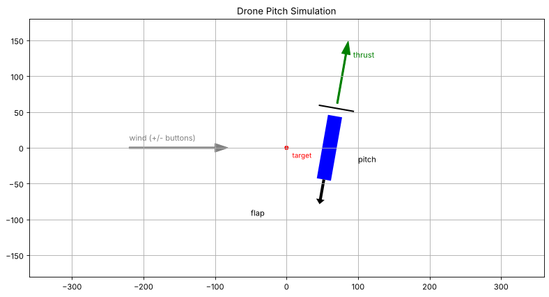

# Simple-Drone-Simu

A side-view (1 axis) simulation of a single-propeller drone that controls its pitch with a flap placed under the propeller. Used to test how the drone drifts with wind and how the flap angle changes its pitch.



Blue: drone body. Black bar: propeller. Black arrow: flap. Red dot: target position.

## Model

| Parameter | Value |
|---|---|
| Mass | 2.2 kg |
| Thrust | 22 N |
| Flap area | 60 cm x 14 cm, 0.2 m below the centre of mass |

Each step:

1. Flap force = lift coefficient (flap angle / 20) x dynamic pressure x flap area.
2. Flap force x 0.2 m = torque -> pitch rate -> pitch.
3. Horizontal force = thrust x sin(pitch) + wind.
4. Horizontal acceleration -> speed -> position.

Buttons: Wind -, Wind +, Start, Stop.

## Running

```bash
pip install -r requirements.txt
streamlit run app.py
```

## Status

Work in progress. `app.py` currently contains two versions mixed together: the original Jupyter/ipywidgets version and a Streamlit port. The Jupyter part needs `IPython` and `ipywidgets` and stops the Streamlit app from starting. The flap angle is fixed at 0 for now, so there is no controller yet.
